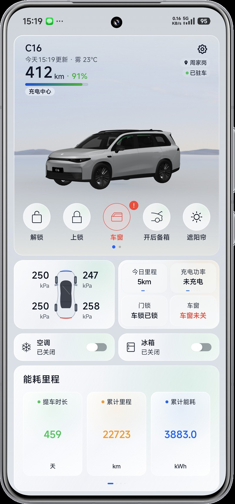

# 零跑智控

零跑智控是一款基于 Kotlin、Jetpack Compose 构建的非官方零跑汽车 Android 车况与远程控车应用，专为个人学习与日常自用车主打造。直接对接零跑官方服务接口，实现高响应度车况读取、全套安全控车与无感近场钥匙。

<p align="center">
  
</p>

> **免责声明**：本项目为非官方个人开源项目，不代表零跑官方。仅供个人技术研究与日常用车便利，请在确认车辆周围环境安全的前提下使用远程控制功能。

---

## 项目亮点

- **智能座舱·真微晶毛玻璃（Liquid Crystal Glassmorphism）**  
  融合高端新能源座舱仪表美学，双对角微晶流光渐变、高光切边与环境极光折射；100% 依赖 Jetpack Compose Canvas/Brush 硬件加速高效渲染，零外部重度模糊库依赖，低端设备保持 60/120 FPS，安装包体积严格控制在 10 MiB 以内。
- **纯电 / 增程双动力深度适配**  
  智能识别硬件信号与车型配置：纯电车型显示单电量槽与纯电续航；增程车型自适应呈现油电双续航看板、油量与电量双进度条，支持手动与智能预选动力模式。
- **BLE 无感蓝牙车钥匙**  
  集成低功耗蓝牙车钥匙，支持近场自动扫描、SM2 国密握手鉴权、近车迎宾与离车自动锁闭，以及毫秒级低延迟本地蓝牙遥控。
- **桌面小组件与系统级快捷操作**  
  提供 4x2 经典小组件与紧凑型小组件，支持 4 档微晶透明度切换与快捷控制槽位自定义；集成 Android 下拉控制中心快捷设置磁贴（Quick Settings Tiles），控车触手可及。
- **本地硬件安全与隐私保护**  
  4 位操作密码与凭证采用 Android Keystore + AES-GCM 硬件级加密；车辆经纬度仅在内存中按需驻留，坐标数据仅在用户主动点击导航时传递给外部地图，绝无隐蔽后台追踪与数据上传。

---

## 当前基线

| 项目 | 配置 |
| --- | --- |
| 应用名称 | 零跑智控 |
| 包名 | `com.leapauto.app` |
| 当前版本 | `4.2.10`（versionCode: `4002010`） |
| 系统要求 | Android 8.0+（`minSdk 26`, `compileSdk / targetSdk 35`） |
| 技术栈 | Kotlin 2.1 + Jetpack Compose + Material 3 + JDK 17 |
| 体验分发 | [蒲公英下载页](https://www.pgyer.com/lingpaozhikong) |

---

## 核心功能

### 1. 远程控制矩阵
- **车身与门锁**：车门上锁/解锁、前备箱开闭、后备箱开闭、天幕遮阳帘开闭；
- **车窗微调**：车窗通风、车窗半开、车窗全关，以及车窗开合百分比滑动调节；
- **智能安防**：鸣笛寻车、开启/关闭哨兵模式、未关门窗异常实时提醒；
- **空调温控**：空调一键启停、16~32°C 精准温度调节、极速制冷、极速制热、前挡除霜除雾、快速除味；
- **舒适座舱**：主驾/副驾座椅加热与通风（0~3档）、后排座椅加热/通风、方向盘加热、后视镜加热、车载冰箱控制（冷藏/冷冻/保温、急速/标准、离车保持）；
- **充放电管理**：开始/停止充电、解锁充电枪、预约充电计划、健康充电电量上限设定（如80%/90%限制）、电池预热。

### 2. 车况与能耗中心
- **实时车况**：车内外温度、总里程、车速、挡位、四轮胎压与胎温监测；
- **续航看板**：纯电续航、燃油续航（增程）、SOC 百分比、实时充电功率/电压/电流及充满预估倒计时；
- **能耗统计**：近7天行驶里程折线图（支持今天/昨天智能相对日期）、周度电耗趋势曲线、能耗构成分析（行车/空调/其他）；
- **位置感知**：高德 Web 逆地理道路地址解析（支持专属 Key 配置与熔断自愈）、地库底盘停车照片寻车、一键调起外部地图导航（高德/百度/腾讯/系统地图）。

---

## 📖 用户使用指南

### 1. 登录与安全鉴权
- **账号登录**：输入零跑绑定手机号，获取短信验证码直接登录；
- **4位控车密码**：远程控车（开关锁、开空调等）需要输入您在零跑官方 App 上设置过的 **4 位数字操控密码**；密码保存在本地 Android Keystore 硬件级加密存储中，仅用于指令签名，绝不上传云端。

### 2. 桌面小组件配置
- **添加组件**：在手机桌面长按空白处 -> 点击「添加微件/小组件」-> 找到「零跑智控」，添加 **4×2 大组件** 或 **2×2 紧凑小组件**；
- **个性化设置**：打开 App -> 进入「我的」页面：
  - **背景风格**：支持「微晶毛玻璃」与「原厂主题实景皮肤」切换；
  - **透明度调节**：经典微晶风格支持 100%、75%、50%、25% 四档通透度调节；
  - **自定义按钮**：支持自定义 4×2 小组件下方 5 个快捷按键的操作功能（拖拽排序）；
  - **清晰度优化**：采用高清字形渲染，彻底消除文字脏黑光晕，强光与深色模式下均像素级锐利。

### 3. 下拉通知栏控制中心磁贴（Quick Settings）
- **一键快捷控车**：下拉手机状态栏控制中心 -> 点击「编辑」按钮 -> 将「车锁」、「空调」、「寻车」磁贴拖入常用面板；
- **自适应反馈与防抖**：车锁磁贴支持上锁/解锁状态自适应切换，内置 15 秒云端延迟防回退保护与指令并发防丢保护。

### 4. 爱车主图与 3D 沉浸式展台
- **主题切换**：进入「我的」-> 点击「3D 展台与小组件主题」，可自由选择「层峦叠嶂」、「雾川雪境」、「余晖石筑」等原厂沉浸式实景天空盒；
- **自定义主图**：在「爱车主图定制」中可从相册上传个性化爱车抠图（如战舰/超跑），或随时一键「恢复官图」。

### 5. 高德地图位置解析（专属 Web Key）
- **道路位置反查**：首页顶部与车辆位置会自动将 GPS 经纬度逆地理反查为具体街道门牌（如“樊城区人民检察院”）；
- **配置指南**：进入「我的」-> 点击「高德地图 Web 服务 Key」，填入您在高德开放平台免费申请的 Web 服务 Key（个人免费额度每日 5,000 次），享有专属独立请求配额；内置智能熔断自愈机制。

### 6. 车机系统 OTA 升级管理
- **固件检测**：进入「我的」->「车机系统 OTA」，可随时查询零跑官方服务器是否有最新车机系统推送；
- **全流程管控**：支持查看完整更新日志、远程推送下载、立即安装或**预约夜间闲时自动升级**（车主主账号专属功能，严格遵循车端安全门禁）。

### 7. BLE 蓝牙数字钥匙
- **近场直连控车**：进入「我的」-> 开启「蓝牙数字钥匙」，支持近场无网状态下通过低功耗蓝牙实现毫秒级开锁/闭锁，以及近车迎宾与离车落锁；
- **使用建议**：为杜绝与官方零跑 App 后台争抢蓝牙信道引起断连，建议在使用前确认蓝牙后台权限，日常亦可搭配手机系统自带 NFC 钥匙配合使用。

### 8. 多座驾切换与动力模式
- **多车独立记忆**：名下拥有多台零跑时，在顶部或「我的」中均可一键「切换座驾」，各车辆配置、车模资产、蓝牙钥匙完全独立隔离；
- **动力模式自适应**：在「动力模式设置」中支持纯电（单电量槽与纯电续航）与增程（油电双续航与双进度条）模式自由切换。

### 9. 检查更新与安全退出
- **应用内极速更新**：在「当前版本」中可一键检测最新 Release 版本，并支持直接在应用内无感下载安装；
- **隐私安全登出**：退出登录将即时彻底擦除设备存储的 Session 凭证、车辆数据与 Android Keystore 硬件级加密操控密码，保障个人账号安全。

---

## 快速上手与本地构建

### 环境要求
- Android Studio Ladybug / Koala 或更高版本
- JDK 17
- Android SDK Platform 35

### 编译与测试
在项目根目录下通过 PowerShell 执行：

```powershell
# 编译 Debug 安装包
.\gradlew.bat :app:assembleDebug

# 执行全量单元测试（包含 103 个 JVM 自动化测试套件）
.\gradlew.bat :app:testDebugUnitTest

# 代码与资源静态检查
.\gradlew.bat :app:lintDebug
```

> **更多开发规范**：  
> - 完整接口规范、协议分析与 reverse-engineering 笔记请查阅 [API/API.md](API/API.md) 及 `API/` 知识库；  
> - 协作流程、发版门禁与代码架构详见 [AGENTS.md](AGENTS.md)；  
> - 界面设计规则详见 [design/零跑智控-设计规范.md](design/零跑智控-设计规范.md)。

---

## 支持作者

Buy me a coffee!

| 微信支持 | 支付宝支持 |
| :---: | :---: |
|  |  |
| **微信扫码** | **支付宝扫码** |

---

## 许可与责任声明

本项目仅供个人学习与日常自用交流，不包含任何收费或商业行为。使用远程控制功能时请严格遵守当地道路交通法规与车辆厂商安全须知。